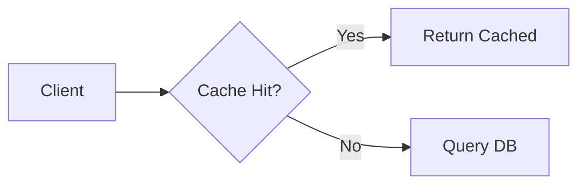

# md2pdf

Convert Markdown notes into print-ready **A4 PDFs** — built for interview prep,
where a plain Markdown-to-PDF export usually mangles code blocks, ASCII
diagrams, and system-design sketches into unreadable plain text.

## What it does differently

- **Any fenced code language** gets real syntax highlighting — ` ```python `,
  ` ```java `, ` ```go `, ` ```sql `, etc. (not hardcoded to one language)
- **Mermaid diagrams** ( ` ```mermaid ` blocks — flowcharts, sequence
  diagrams, ER diagrams) render as real vector graphics, not literal text
- **ASCII box/arrow diagrams** (`╔══╗`, `──▶`, etc.) keep exact character
  alignment — never word-wrapped, only shrunk to fit if too wide for the page
- **Unlabeled pseudocode** stays monospace and wraps safely, since there's no
  alignment to protect
- **Relative image paths** in the Markdown resolve against the input file's
  own folder
- Always outputs **A4** (landscape by default, portrait optional) — long code
  lines and diagrams need the width, so landscape is the default; use
  `--portrait` for prose-heavy notes

## Requirements

- [Node.js](https://nodejs.org/) **>= 22.12.0**

## Install

```bash
git clone https://github.com/<your-username>/md2pdf.git
cd md2pdf
npm install
```

The first `npm install` downloads a bundled Chromium for Puppeteer (~200MB) —
this is normal and only happens once per machine.

> **Note:** newer npm versions block package postinstall scripts by default
> for supply-chain safety. If you see a warning like
> `1 package has install scripts not yet covered by allowScripts`, run:
> ```bash
> npm approve-scripts puppeteer
> ```
> This lets Puppeteer download its bundled Chromium. You only need to do this
> once per machine/clone.

### Make it a global command (optional)

```bash
npm link
```

This makes `md2pdf` available as a command from any folder on this machine.
Without this step, you can still run it directly with `node bin/md2pdf.js`.

## Usage

```bash
md2pdf notes.md                    # writes notes.pdf next to notes.md
md2pdf notes.md output.pdf         # custom output path
md2pdf notes.md --portrait         # A4 portrait instead of landscape
```

Or without `npm link`:

```bash
node /path/to/md2pdf/bin/md2pdf.js notes.md
```

## Using it on a new machine

1. Clone this repo
2. `npm install` (approve the Puppeteer postinstall script if prompted — see
   above)
3. `npm link` if you want the global `md2pdf` command
4. Run it on any `.md` file, from anywhere

## Example

````markdown
```python
def two_sum(nums, target):
    seen = {}
    for i, n in enumerate(nums):
        if target - n in seen:
            return [seen[target - n], i]
        seen[n] = i
```


````

Both render as real syntax-highlighted code and a real flowchart in the
output PDF.

## License

MIT
